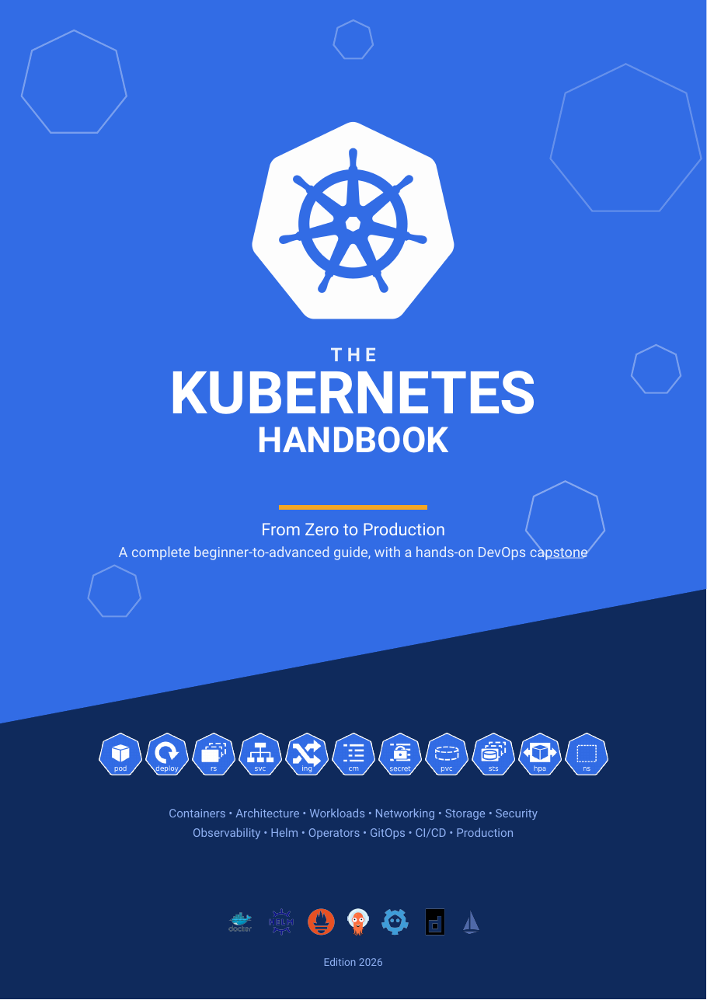
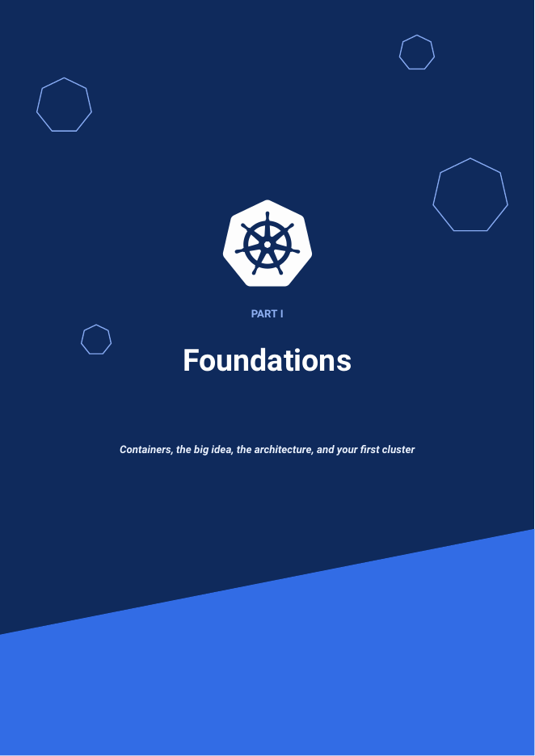
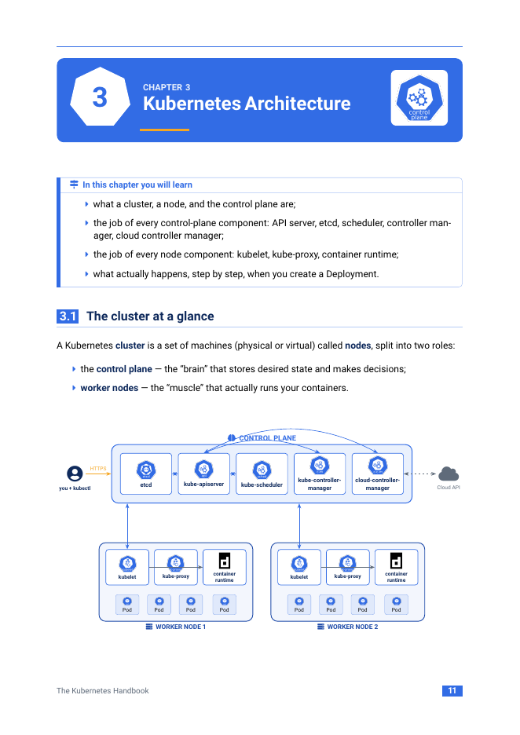
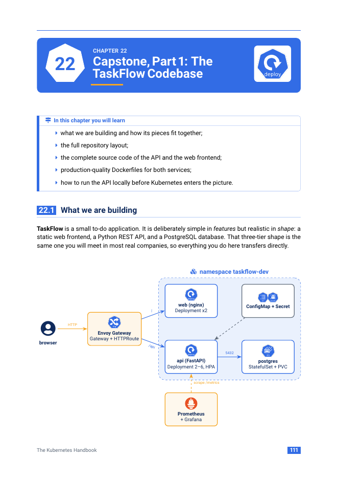
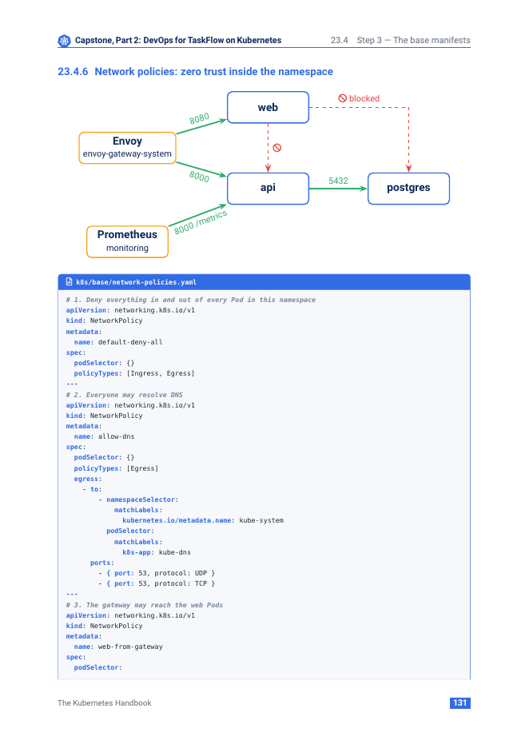

<div align="center">

<a href="main.pdf"></a>

# The Kubernetes Handbook

**From Zero to Production: a complete beginner-to-advanced guide, with a hands-on DevOps capstone**

[](main.pdf)
[](https://github.com/fahiiim/Kubernetes-handbook/raw/main/main.pdf)
[](main.tex)

</div>

---

## Read the handbook

**[Open `main.pdf`](main.pdf)** (172 pages). GitHub shows it in its built-in PDF viewer; use the download button above to keep a copy.

## Preview

<table>
  <tr>
    <td align="center"><a href="main.pdf"></a><br><sub>Part pages</sub></td>
    <td align="center"><a href="main.pdf"></a><br><sub>Cluster architecture</sub></td>
    <td align="center"><a href="main.pdf"></a><br><sub>TaskFlow capstone</sub></td>
  </tr>
  <tr>
    <td align="center" colspan="3"><a href="main.pdf"></a><br><sub>Zero-trust network policies with real manifests</sub></td>
  </tr>
</table>

## What's inside

| Part | Topics |
|------|--------|
| **I. Foundations** | Containers and Docker, what Kubernetes is, cluster architecture, local lab setup (kind), kubectl and YAML |
| **II. Running Workloads** | Pods and probes, labels and namespaces, Deployments and rollouts, StatefulSets, DaemonSets, Jobs, CronJobs |
| **III. Networking** | Services and DNS, Ingress, Gateway API, cert-manager, NetworkPolicies, CNI |
| **IV. Configuration & Storage** | ConfigMaps, Secrets, External Secrets, volumes, PV/PVC, StorageClasses, snapshots |
| **V. Operating Kubernetes** | Requests/limits, scheduling, autoscaling (HPA, VPA, KEDA), RBAC, Pod Security, observability |
| **VI. Advanced** | Helm, Kustomize, CRDs and Operators, CI/CD, GitOps with Argo CD, running in production |
| **VII. Capstone** | **TaskFlow**: a FastAPI + PostgreSQL + nginx app taken through images, manifests, overlays, autoscaling, network policies, monitoring, GitHub Actions CI and Argo CD GitOps |
| **Appendices** | kubectl cheat sheet, troubleshooting playbook, glossary and learning path |

## Build it yourself

The book is written in LaTeX and compiles with **pdfLaTeX**.

**Overleaf:** upload the repository as a zip, set the compiler to pdfLaTeX, and compile.

**Locally** (TeX Live or MiKTeX):

```bash
pdflatex main.tex
pdflatex main.tex   # second run updates the table of contents and cover overlay
```

## Repository layout

```
main.tex              # document entry point and cover page
style/k8s-style.tex   # Kubernetes colour palette, fonts, boxes, code listings
chapters/             # one file per chapter and appendix
images/               # official Kubernetes icons and project logos
preview/              # page images used in this README
main.pdf              # the compiled handbook
```

## Credits

Kubernetes and the Kubernetes logo are trademarks of The Linux Foundation. Resource icons come from the official [kubernetes/community](https://github.com/kubernetes/community/tree/master/icons) repository. Docker, Helm, Prometheus, Argo, etcd, containerd, Istio and cert-manager names and logos belong to their respective owners and are used only to identify those projects.

Licensed under the [Apache License 2.0](LICENSE).
